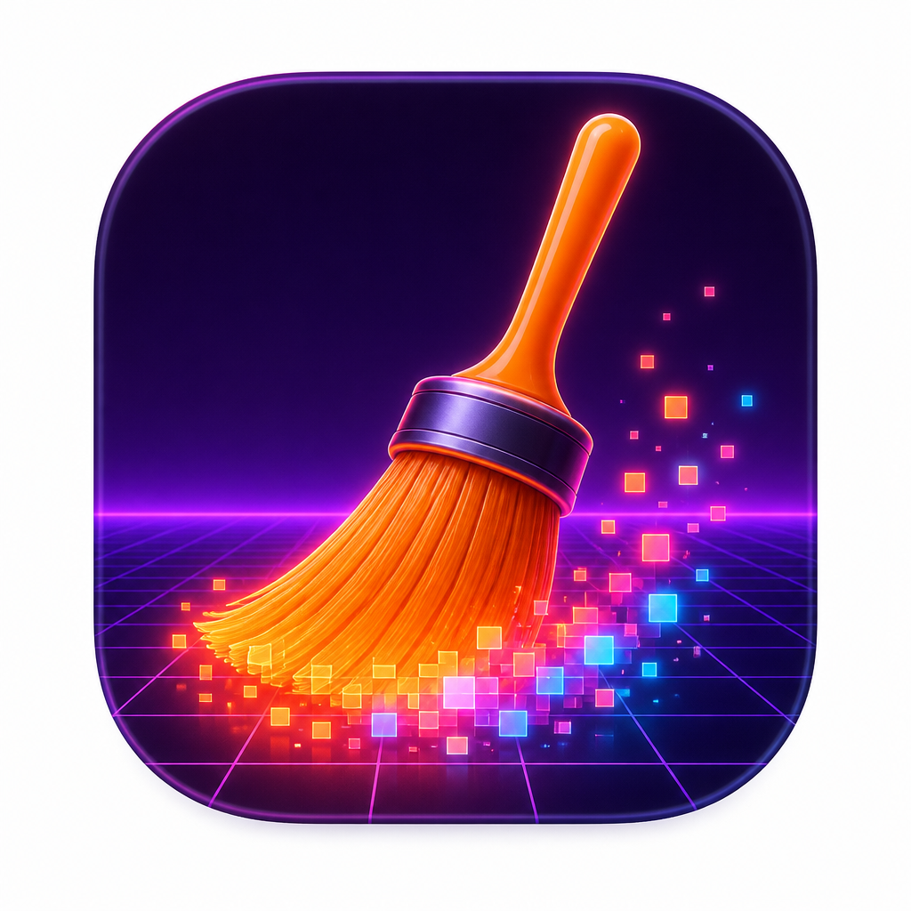
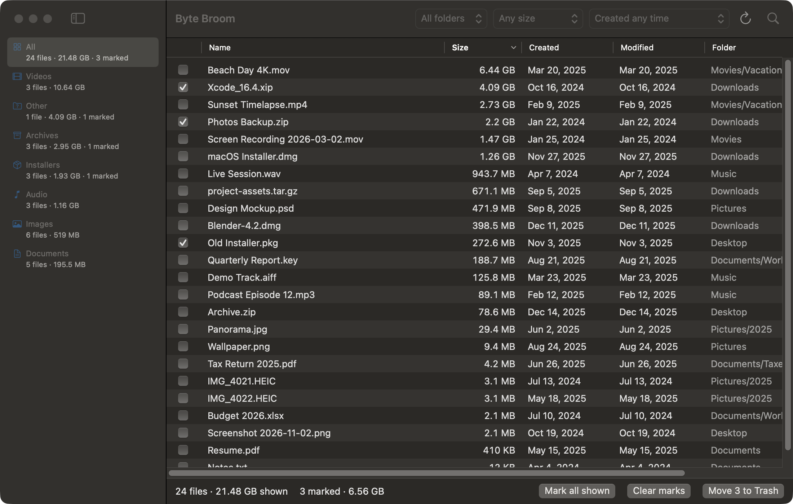
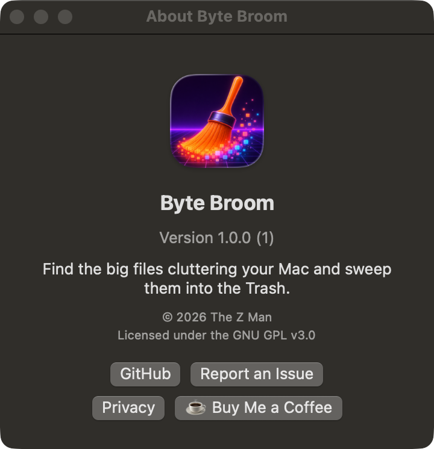

<p align="center">
  
</p>

<h1 align="center">Byte Broom</h1>

<p align="center">Find the big files cluttering your Mac and sweep them into the Trash.</p>

<p align="center">
  <a href="https://github.com/zachabernathy/byte-broom/releases/latest"></a>
  <a href="https://github.com/zachabernathy/byte-broom/actions/workflows/ci.yml"></a>
  <a href="LICENSE"></a>
  <a href="https://buymeacoffee.com/thezman"></a>
</p>

<p align="center">
  
</p>

## Features

- Scans your Desktop, Documents, Downloads, Movies, Music, and Pictures folders and lists your files, biggest first.
- Groups files by type: Documents, Videos, Images, Audio, Installers, Archives, Apps, and Other, with a count and total size for each.
- Sorts by name, size, date created, date modified, or folder.
- Filters by folder, minimum size, and age, and searches by file name.
- Shows apps, Photos and Music libraries, and packages like Pages documents as one item with their total size.
- Moves the files you tick to the Trash. Nothing is deleted permanently, and Put Back in Finder works as usual.
- Small, native, and fast. Built with SwiftUI and no third-party code.

<p align="center">
  
</p>

## Install

1. Download `ByteBroom-x.y.z.dmg` from the [latest release](https://github.com/zachabernathy/byte-broom/releases/latest).
2. Open the DMG and drag **Byte Broom** to **Applications**.
3. Open Byte Broom from Applications.

**Requirements:** a Mac with Apple silicon, macOS 14 Sonoma or later.

### Opening it the first time

Byte Broom doesn't come from the Mac App Store and isn't notarized yet, so macOS may refuse to open it the first time. To allow it:

1. Close the message.
2. Open **System Settings > Privacy & Security**.
3. Scroll down and click **Open Anyway** next to the note about Byte Broom.
4. Confirm. macOS remembers your choice.

Or, in Terminal:

```bash
xattr -dr com.apple.quarantine "/Applications/Byte Broom.app"
```

### Folder access

macOS asks before an app can read folders like Desktop, Documents, and Downloads. Click **Allow** when Byte Broom asks. If you clicked Don't Allow, turn those folders on for Byte Broom in **System Settings > Privacy & Security > Files and Folders**, then click **Rescan** (⌘R).

Your Photos library shows a smaller size than the real one unless Byte Broom has **Full Disk Access** (System Settings > Privacy & Security > Full Disk Access). Quit and reopen Byte Broom after turning it on.

## Privacy

- No analytics, no telemetry, no accounts.
- Byte Broom reads file names, sizes, and dates, and that list never leaves your Mac.
- It only connects to the internet when you choose **Byte Broom > Check for Updates…**, which sends one request to the GitHub API for the latest version number. Nothing about your files is sent.

## Verify a download

Each release includes a SHA-256 checksum and a build provenance attestation. Download `ByteBroom-x.y.z.dmg.sha256` next to the DMG, then:

```bash
shasum -a 256 -c "ByteBroom-x.y.z.dmg.sha256"
gh attestation verify "ByteBroom-x.y.z.dmg" --repo zachabernathy/byte-broom
```

The second command needs the [GitHub CLI](https://cli.github.com) and confirms the DMG was built by this repository's Release workflow.

## Build from source

With full Xcode installed:

```bash
git clone https://github.com/zachabernathy/byte-broom.git
cd byte-broom
scripts/build-app.sh --install
```

This runs the tests, builds `Byte Broom.app`, and copies it to `~/Applications`. See [CONTRIBUTING.md](CONTRIBUTING.md) for details, including how to test against a throwaway folder.

## Support

If Byte Broom saved you some space, you can [buy me a coffee](https://buymeacoffee.com/thezman). ☕

Found a bug or have an idea? [Open an issue](https://github.com/zachabernathy/byte-broom/issues/new/choose).

## License

Byte Broom is free software under the [GNU General Public License v3.0](LICENSE).

© 2026 The Z Man
